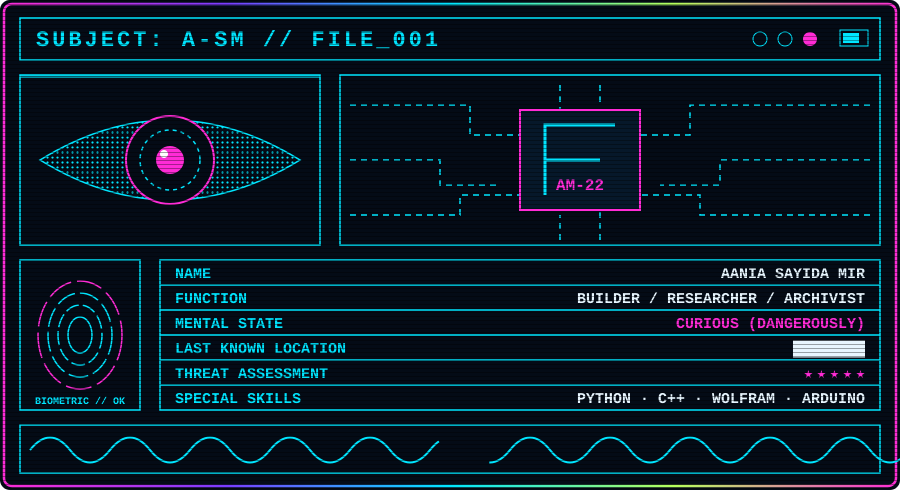
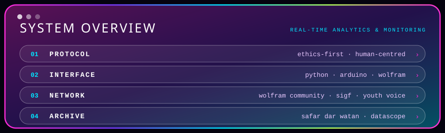
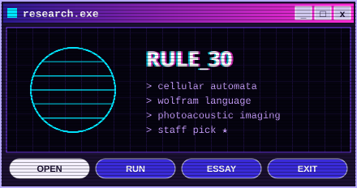
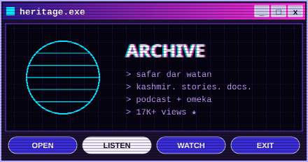
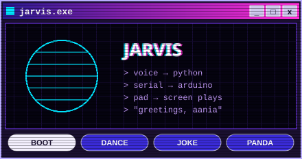
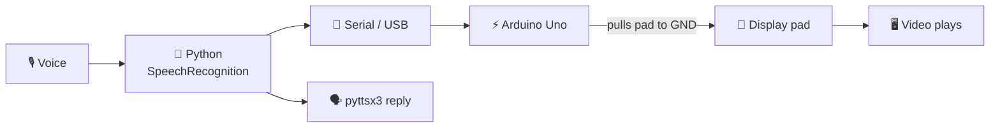

<div align="center">









</div>

<br/>

<div align="center">

### ✦ OPEN A WINDOW ✦

<a href="#-rule-30--my-favourite-thing-in-the-universe"></a>
<a href="https://safardarwatan.omeka.net/"></a>
<a href="#-jarvis-display--voice-controlled-cyberdeck"></a>

</div>


## 🧬 Rule 30 : my favourite thing in the universe

I researched **periodicity in the vertical centre columns of cellular automata** in the **Wolfram High School Summer Research Program**, and my computational essay became a **Wolfram Community staff pick**. This is Rule 30 growing from one cell:

```text
····················█····················
···················███···················
··················██··█··················
·················██·████·················
················██··█···█················
···············██·████·███···············
··············██··█····█··█··············
·············██·████··██████·············
············██··█···███·····█············
···········██·████·██··█···███···········
··········██··█····█·████·██··█··········
·········██·████··██·█····█·████·········
········██··█···███··██··██·█···█········
·······██·████·██··███·███··██·███·······
······██··█····█·███···█··███··█··█······
·····██·████··██·█··█·█████··███████·····
```

<details>
<summary><b>▸ decrypt: what I actually found interesting</b></summary>
<br/>

- Rule 30's centre column passes randomness tests, yet comes from a **one-line deterministic rule**.
- My project asked whether hidden periodic structure shows up in the centre columns across rules.
- Now continuing in the **Wolfram Emerging Leaders Program**: a computational essay on the **physics and modelling of photoacoustic imaging**, in Wolfram Language.

```wolfram
ArrayPlot[CellularAutomaton[30, {{1}, 0}, 100]]
```

</details>


## 🤖 Jarvis Display : voice-controlled cyberdeck

<details>
<summary><b>▸ boot jarvis.exe</b></summary>
<br/>



- Reverse-engineered a video-brochure PCB (board `V607D-V01`) and mapped its button pads
- Arduino fakes presses with the open-drain trick (`INPUT` ↔ `OUTPUT LOW`), so a 5V board never harms a 3.3V one
- Stack: Arduino C++ · Python · pyserial · SpeechRecognition · pyttsx3

</details>

## 🏔️ Safar Dar Watan, Datascope & more

<details>
<summary><b>▸ open heritage.exe : Safar Dar Watan</b></summary>
<br/>

- Founded a **multimedia digital archive** (Omeka.net) and a **podcast** of Kashmiri voices
- Directed and edited two documentaries: *Gyavun: Echoes of the Valley* (17K+ views) and *Etchings in Stone*
- Led an architectural walking tour reaching 900+ people
- Research lens: consent, community and the psychology of preservation

[🌐 Archive](https://safardarwatan.omeka.net/) · [🎙️ Podcast](https://open.spotify.com/show/7mAIw2bOGrkhVEfROZoXq4) · [▶️ YouTube](https://youtube.com/@safardarwatan22)

</details>

<details>
<summary><b>▸ open datascope.exe : privacy for under-18s</b></summary>
<br/>

- Co-founded an initiative on how websites collect and use data, with a focus on young users
- Surveyed **118 people** on privacy awareness and tracking concerns

</details>

<details>
<summary><b>▸ open games.exe : simulations & arcade</b></summary>
<br/>

- 👾 **Space Invader**: arcade game with levels and a high score
- 🧫 **Conway's Game of Life**: zero-player simulation
- 🐚 **Fibonacci Visualiser**: turtle-graphics spirals
- 🌿 **Green Wings**: eco-business concept (1st place, Business Battlefield)

</details>


## 💾 Top 8 (yes, like Spacehey)

| 1 | 2 | 3 | 4 |
|:-:|:-:|:-:|:-:|
| 🐍 **Python** | ⚡ **Arduino** | 🔶 **Wolfram Language** | 🌐 **HTML/CSS** |
| 🐳 **Docker** | 🌿 **Git** | 📊 **Google Sheets** | 🗃️ **Omeka** |

> **mood:** ✦ cyber angel &nbsp;|&nbsp; **now playing:** my own podcast (yes, really) &nbsp;|&nbsp; **status:** building

<div align="center">

### 📊 SYSTEM STATS


### 🐍 snake.exe is eating my commits

<picture>
  <source media="(prefers-color-scheme: dark)" srcset="https://raw.githubusercontent.com/aaniasmir22/aaniasmir22/output/github-snake-dark.svg"/>
  
</picture>


### 🏆 ACHIEVEMENTS UNLOCKED

🥇 1 of 70 students worldwide, Wolfram Summer Research Program &nbsp;·&nbsp; 🔬 Wolfram Emerging Leaders invite<br/>
🏆 1st place, Mental Wellness App (Appify Tech Week '24) &nbsp;·&nbsp; 🎤 Best Delegate, UNCSW at YALE MUN × GD Goenka<br/>
🎬 17K+ views on a Kashmiri music documentary &nbsp;·&nbsp; 🌍 Technical developer, Student Internet Governance Forum

<br/>

[](https://www.linkedin.com/in/aania-sayidamir-50460134a)
[](https://open.spotify.com/show/7mAIw2bOGrkhVEfROZoXq4)
[](https://youtube.com/@safardarwatan22)
[](https://github.com/aaniasmir22/aaniasmir22/issues/new?title=%E2%9C%A6%20Guestbook%20signature&body=name%3A%20%0Aleft%20from%3A%20%0Amessage%3A%20)


*✦ SYSTEM ANGEL // ONLINE ✦*

</div>
